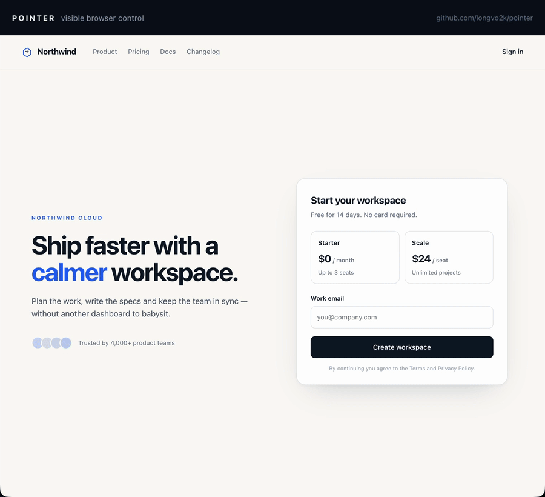

# Pointer

Let any agent drive your real Chrome tab, with a pointer you can watch.

An agent often needs a page that is already open in your browser, with your session. A second
profile means another login and a different session, and a headless browser cannot reach the page at
all. Pointer uses a local hub and a Chrome extension to act in that tab, and draws each move on
screen.

- One MCP server for Claude Code / Cursor / OpenCode / Codex, plus a plain CLI. The extension drives
  the tab you already have open, so you do not need a second profile or another login, and the
  browser keeps its normal fingerprint.
- Before a click lands, the cursor slides to the target with a label ("click · Sign Up") and a
  ripple. `Esc` or a real click on the page stops the agent; the next tool call tells it to ask first.
- Clicks and keys go through CDP (`chrome.debugger`) instead of synthetic DOM events, so React
  handlers and pointer checks behave.
- Every tab the agent drives moves into a Chrome tab group named after the agent (for example,
  Claude), and the tab title carries the same badge.
- Only `tab_open` and `tab_focus` bring a tab forward. Snapshot, click, fill, scroll, read, and
  screenshot keep working while you are in another tab or window.

[](demo/pointer-demo.mp4)

https://github.com/user-attachments/assets/e8df2fb0-d19f-4ba1-b4aa-2581bf8e3aef

<sub>14s GIF preview, then the full 32s walkthrough. Left: the CLI. Right: the page, with Pointer's
cursor and action labels drawn by the extension. [MP4 file](demo/pointer-demo.mp4).</sub>

## How it works

```
agent (MCP or CLI)
      │
      ▼
 local hub  (ws + http on 127.0.0.1:8790)
      │
      ▼
 Chrome extension  ── chrome.debugger (trusted input)
      │
      ▼
 your tab  ── overlay: pointer, label, ripple, target outline
```

The extension is the only part that touches Chrome. It holds the hub connection, the
`chrome.debugger` session, and the on-page overlay. The hub routes each tool call to the active
browser and tab, and both the CLI and the MCP server call the same tools.

## Install

Install with one command:

```bash
curl -fsSL https://raw.githubusercontent.com/longvo2k/pointer/main/install.sh | bash
```

It clones into `~/.pointer`, installs dependencies, links `pointer` and `pointer-mcp` into
`~/.local/bin`, and opens `chrome://extensions` with the extension folder revealed. Re-run it any
time to update. Set `POINTER_DIR` to install elsewhere, or `POINTER_NO_OPEN=1` to skip opening Chrome.

Then load the extension once. Chrome does not let a page install an unpacked extension for you:

1. `chrome://extensions` → **Developer mode** → **Load unpacked**
2. choose `~/.pointer/extension`

The toolbar badge shows `on` when it is connected. Check that it works:

```bash
pointer status
pointer open news.ycombinator.com
pointer snap
```

`pointer setup` reopens the extension page, copies the folder path, and prints an MCP config with
your actual paths.

<details>
<summary>From a checkout (development)</summary>

```bash
git clone https://github.com/longvo2k/pointer && cd pointer
npm install
node bin/pointer.mjs setup
```

Then use `node bin/pointer.mjs …` in place of `pointer …` below.

</details>

### Multiple browsers and extension reloads

If more than one Chrome profile has Pointer loaded, the hub keeps the first one it saw and leaves the
others connected but idle. That is deliberate: silently switching browsers would send clicks to a
different session. Check and choose explicitly:

```bash
pointer browsers
pointer use 3f9c1a2b
```

Each line shows a short connection id, the build, and whether it is active.

When you edit the extension, Chrome may keep serving the old copy of an unpacked extension even after
a restart (this is easy to spot: the toolbar works, but the change is not there). Click **Reload** on
`chrome://extensions`, or remove it and **Load unpacked** again. On Chrome 137+ a reloaded unpacked
extension can be disabled as an "unsupported developer extension"; loading a copy from a new folder
gets a fresh id and avoids that. `pointer reload` asks every connected extension to reload itself
(useful once the new build is already running).

## Use from an agent

### MCP (Claude Code, Cursor, OpenCode, …)

```json
{
  "mcpServers": {
    "pointer": {
      "command": "node",
      "args": ["/Users/you/.pointer/bin/mcp.mjs"]
    }
  }
}
```

Run `pointer setup` to print this snippet with your real path, or with Claude Code:

```bash
claude mcp add pointer -- node ~/.pointer/bin/mcp.mjs
```

Tools: `browser_status`, `tabs_list`, `tab_open`, `tab_focus`, `snapshot`, `click`, `fill`, `press`,
`scroll`, `read_text`, `wait_for`, `screenshot`, `stop`.

The usual loop is short:

```
snapshot  →  click e12  →  snapshot
```

`snapshot` returns compact text with refs (`- button "Try PAVE" [ref=e12]`) instead of a DOM dump.
Refs reset on navigation, so re-snapshot after the page changes.

### CLI (shell agents)

```bash
pointer open https://paveinspect.com/
pointer snap
pointer click e14
pointer fill e9 "hello" --json
pointer shot out.png
pointer browsers
pointer use 3f9c1a2b
```

## Design boundaries

- Snapshot covers the top frame. It does not traverse open shadow roots or reach into iframes yet.
- There is no `eval` tool. Arbitrary JS in a logged-in tab turns a bug into an incident.
- One browser is active at a time. If several Chrome profiles run the extension, the hub keeps the
  first one active instead of switching silently; `pointer browsers` lists them and `pointer use <id>`
  chooses another. (Multiple agents sharing tabs is still the next step.)

## Skill for agents

[`skills/pointer`](skills/pointer) is an Agent Skill for Claude Code, OpenCode, or any harness that
reads `SKILL.md`. It covers when to use Pointer and when to stop: confirm before irreversible
actions, never handle credentials, and treat Escape or a real click as a hard stop rather than a
retry.

```bash
ln -s "$PWD/skills/pointer" ~/.claude/skills/pointer
```

Start a new session so the skill appears in the agent's skill list. The bundled
`skills/pointer/scripts/pointer` wrapper resolves the checkout from its own location, so the same
skill works linked from a skills directory, copied into a project, or run from the repo.

## Where the code lives

The code is split along the trust boundary. `extension/` is the only part that runs inside Chrome.
The service worker owns the hub connection and the debugger session; the content script owns
snapshots and the overlay. `lib/` is the local hub and the shared tool layer. `bin/` exposes those
tools as a CLI and an MCP stdio server. `skills/pointer/` holds the agent-facing policy, and `demo/`
holds the walkthrough video and GIF used above.

When adding behavior, keep that boundary: browser mechanics go in the extension, new tools and their
formatting in `lib/tools.mjs`, and agent guidance in the skill. The hub should stay a router. It is
the only place that knows which browser and tab is active.

## Configuration

| Variable | Default | Meaning |
|---|---|---|
| `POINTER_PORT` | `8790` | hub port (extension connects here) |
| `POINTER_FOCUS_WINDOW` | `1` | raise the OS window for `tab_open` / `tab_focus` (other actions never steal focus) |
| `POINTER_AGENT` | `agent` | name shown in status and the tab-title badge (`Claude · PAVE Inspect`) |

## Acknowledgements

Pointer was written from scratch. Its approach, a Chrome extension that drives your own tab over
`chrome.debugger` with a pointer you can watch, was inspired by
[ofershap/real-browser-mcp](https://github.com/ofershap/real-browser-mcp). If you want a different
take on the same problem, start there.
